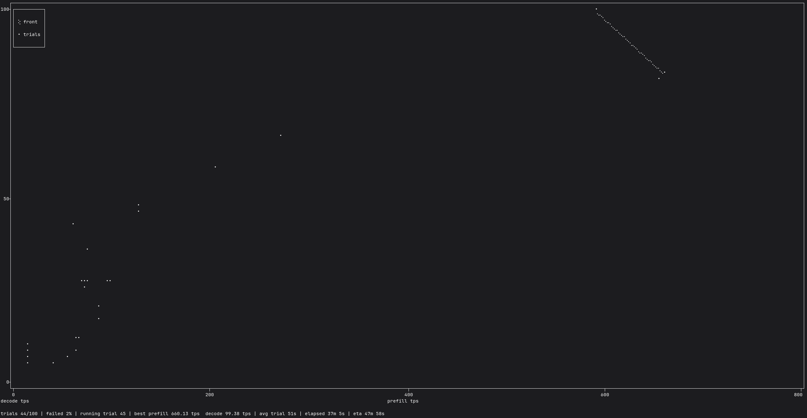

# llm-config-optimization

`llm-config-optimization` is a command-line tool that searches an **LLM serving
configuration** for the best token throughput. You give it a model and a YAML
file describing which serving parameters to sweep and which values each may
take; it runs the model in a Podman container, benchmarks every candidate
configuration through the configured inference engine, and uses
[Optuna](https://optuna.org/) (TPE sampler) to find the best point. Each trial
reports **prefill** and **decode** throughput separately, and by default the
sweep maximizes both at once, producing a Pareto front rather than committing
to a trade-off before the run. Progress is shown live as either a per-trial log
or a terminal graph, and the recommended configuration is printed and
optionally written to a YAML file when the sweep ends.



The inference engine is deliberately pluggable and chosen on the command line:
the search-space and experiment layers are engine-neutral and name no engine, so
the same definition and workflow can target a different backend later. **vLLM
and llama.cpp are implemented today**, and each declares which tunables it
forwards, so a definition names exactly the parameters the selected engine can
serve. A trial starts the engine's server in a container and measures it from
the host through one shared HTTP client, so the container carries only the
server and every engine is measured by identical logic.

The search space is deliberately explicit: every tunable the selected engine
forwards must be declared, so a result is always explainable from the
definition alone. Nothing silently falls back to an engine default unless you
write that decision down.

```console
$ llm-config-optimization Qwen/Qwen3.8-27B space.yaml vllm --n-trials 50 --output-config best.yaml
```

---

## 1. Usage

### Installation

The tool requires **Python 3.14** and a running **Podman daemon**. The project is
managed with [uv](https://docs.astral.sh/uv/), which creates the virtual
environment and installs the `llm-config-optimization` console script from the repo:

```console
$ git clone <repo-url> llm-config-optimization
$ cd llm-config-optimization
$ uv sync
```

From the repository root the command is then callable in any of these ways:

```console
$ uv run llm-config-optimization --help      # uses the project venv, no activation needed
$ source .venv/bin/activate && llm-config-optimization --help
$ uv run python -m llm_config_optimization --help   # equivalent module entry point
```

To make it available outside the repo, install it as a uv tool:

```console
$ uv tool install .
$ llm-config-optimization --help
```

With [Nix](https://nixos.org/), `nix develop` provides Python and uv in a dev
shell; run `uv sync` inside it once to install the Python tooling.

### Synopsis

```
llm-config-optimization MODEL SPACE ENGINE [options]
```

Three positional arguments are required:

| Argument  | Description                                                              |
| --------- | ------------------------------------------------------------------------ |
| `MODEL`   | Model to benchmark: a Hugging Face id (`Qwen/Qwen3.8-27B`) or a host path to a local checkpoint. For `llamacpp`, a `.gguf` file or a GGUF repository with an optional `:QUANT` selector (see [Engines](#engines)). |
| `SPACE`   | Path to the search-space YAML file (see [section 2](#2-search-space-yaml-format)). |
| `ENGINE`  | Inference engine to benchmark: `vllm` or `llamacpp`. It selects the backend that checks the search space, plans the server, and interprets the result. |

Everything else has a default, so the shortest invocation is just the three
positionals. Run `llm-config-optimization --help` for the same documentation on the
command line.

### Engines

The selected engine decides which tunables a space must declare, how `MODEL` is
resolved, which server command runs, and which image is used. Both engines are
driven by the same host-side client, so their workload and metric definitions
are identical, but their defaults and scoped options differ.

| Engine     | Checkpoint                                              | Applicable tunables                                    | Cache reset between runs      | Phase rates from               |
| ---------- | ------------------------------------------------------- | ------------------------------------------------------ | ----------------------------- | ------------------------------ |
| `vllm`     | A Hugging Face id or a local snapshot directory.        | All seven in [section 2](#2-search-space-yaml-format). | vLLM dev-mode endpoints.      | Prometheus `/metrics`.         |
| `llamacpp` | A local `.gguf` file or a Hub repository with `:QUANT`. | The five llama.cpp forwards.                           | None; llama.cpp exposes none. | The `timings` response object. |

The **default images**, used when `--image` is omitted, are:

| Target | vLLM                                     | llama.cpp                                |
| ------ | ---------------------------------------- | ---------------------------------------- |
| `cuda` | `docker.io/vllm/vllm-openai:latest`      | `ghcr.io/ggml-org/llama.cpp:server-cuda` |
| `rocm` | `docker.io/vllm/vllm-openai-rocm:latest` | `ghcr.io/ggml-org/llama.cpp:server-rocm` |
| `cpu`  | `docker.io/vllm/vllm-openai-cpu:latest`  | `ghcr.io/ggml-org/llama.cpp:server`      |

**llama.cpp model argument.** `MODEL` is either a host path to a `.gguf` file
or a Hugging Face repository id, optionally followed by `:` and a selector: the
GGUF file's name or a quantization tag. A repository that holds exactly one GGUF
file needs no selector; one that holds several requires it, so the tool never
guesses which quantization you meant. The exact file name always names one
file — `unsloth/Qwen3.5-0.8B-GGUF:Qwen3.5-0.8B-Q6_K.gguf`; anything shorter is
matched as a case-insensitive substring, so `:q4_k_m` finds `...-Q4_K_M.gguf`
and the `.gguf` suffix may be left off. A shorter selector is only unambiguous
while no other file's name contains it, though: in
`unsloth/Qwen3.5-0.8B-GGUF`, `:Q6_K` also matches the dynamic
`...-UD-Q6_K_XL.gguf` and is rejected with the candidates listed, so name the
file when tags overlap. The resolved file is mounted into the server and its
GGUF metadata is read before the image is pulled: a checkpoint that is not GGUF
is rejected, and the quantization it declares is what the run serves.

`--quantization` and `--gpu-memory-utilization` are **vLLM-only**: for
`llamacpp` both are usage errors (exit code `2`) before any preparation runs,
because a GGUF file carries its own quantization and llama.cpp sizes memory with
its own flags. `--llm-seed` is likewise forwarded by vLLM only; the host
client's workload is greedy, so llama.cpp needs no engine-side seed. Everything
else on the command line behaves the same for both engines.

### Objective and phase metrics

Every measured run is summarised by up to three rates, all in tokens per
second:

- **combined** — all prompt and generated tokens over the run's elapsed
  wall-clock time. This is the historical metric; with a large prompt-to-output
  ratio it is dominated by prompt tokens.
- **prefill** — the prompt tokens the engine reports processing over the
  seconds it reports spending on prefill.
- **decode** — the generated tokens over the seconds the engine reports
  spending on generation.

Prefill and decode are **phase-work rates**, not a partition of the run's
wall-clock time: continuous batching and chunked prefill interleave the two
phases, so only the engine can attribute work to one. Each engine is read from
its own source, and neither needs a flag or a changed image:

| Engine     | Phase-rate source |
| ---------- | ----------------- |
| `vllm`     | The Prometheus `/metrics` endpoint, scraped immediately before and after each measured run. Prefill is the delta of `vllm:prompt_tokens_total` over the delta of `vllm:request_prefill_time_seconds_sum`; decode is `vllm:generation_tokens_total` over `vllm:request_decode_time_seconds_sum`. The prefix cache is reset before every run, so prompt tokens served from it are excluded. |
| `llamacpp` | The `timings` object the server attaches to every completion response: `prompt_n` over `prompt_ms` and `predicted_n` over `predicted_ms`, summed over the run's responses. `prompt_n` already excludes tokens served from the cache. |

A scrape that fails, or a response without timings, leaves the phase rate
absent rather than failing the run. Each run's full payload stays on the result
for audit, and a trial's phase rates are the means over the runs that reported
one — a run without a rate is not counted as zero.

`--objective` chooses what the sweep maximizes:

- **`multi`** (the default) submits prefill and decode as two independent
  objectives, so Optuna keeps a **Pareto front** of non-dominated
  configurations. The trade-off decision is therefore made after the sweep
  rather than baked into weights beforehand; the final summary prints the front
  with a recommended row, the per-trial log and the TUI show both rates, and
  `--output-config` writes the recommended point.
- **`weighted`** folds the two rates into the weighted-harmonic effective rate

  ```
  (w_p + w_d) / (w_p / prefill + w_d / decode)
  ```

  where `w_p` and `w_d` are the prefill and decode weights. The weights are a
  **token mix** — counts, not fractions — so any positive scaling of a pair
  gives the same score, and the result stays a tokens-per-second rate
  interpretable as the throughput of a request shaped like the weights. They
  default to the benchmark's `--input-len` and `--output-len`, so
  `--objective weighted` needs no arithmetic while still biasing the score
  toward the deployment's shape; `--prefill-weight` and `--decode-weight`
  override them. A zero weight degenerates the score to the other phase; both
  zero is rejected. For a JSONL `--dataset-path` the workload's real mix is not
  known at launch, so the derived defaults are only a stand-in — pass explicit
  weights to match the dataset.
- **`combined`** keeps the historical single objective: the mean combined
  throughput of the successful runs. It is the escape hatch for an engine that
  reports no phase data, and how studies persisted before objective modes
  existed are interpreted.

The multi and weighted modes require every phase rate they actually score; a
trial whose engine reported neither a `/metrics` snapshot nor response timings
fails with an error naming the missing source instead of silently optimizing
something else. The combined mode tolerates absent phase data. If no token mix
can be derived for multi or weighted, both weights must be given explicitly.
The weights are validated before any preparation runs: both must be finite and
non-negative, and at least one must be positive, or the run exits with a usage
error.

> **Note:** the prefill and decode rates are new measurements. They are
> engine-reported phase-work rates rather than wall-clock partitions, so they
> are **not comparable** to the combined throughput — and because a study
> records the phase-metric schema version its scores were measured under,
> numbers from different versions are not comparable either.

### Options

#### Container

| Flag             | Values                                   | Default | Description                                                                 |
| ---------------- | ---------------------------------------- | ------- | --------------------------------------------------------------------------- |
| `--target`       | `cuda`, `rocm`, `cpu`                    | auto    | Accelerator class to target; auto-detected from the host when omitted.       |
| `--image`        | any image reference                      | backend | Container image to run; the backend's image for the resolved target.        |
| `--shm-size`     | size string, e.g. `8g`                   | `8g`    | Size of the container's `/dev/shm`; vLLM needs a large one, while llama.cpp is unaffected. |
| `--mem-limit`    | size string, e.g. `16g`                  | unset   | Container memory limit; unlimited when omitted.                              |
| `--pull-policy`  | `missing`, `always`, `never`, `newer`    | `missing` | When to pull the container image.                                          |

#### Benchmark workload

| Flag                | Default      | Description                                                    |
| ------------------- | ------------ | -------------------------------------------------------------- |
| `--dataset-name`    | `random`     | Benchmark dataset to serve prompts from.                       |
| `--dataset-path`    | unset        | Host path to a custom dataset file; the built-in dataset when omitted. |
| `--num-prompts`     | `200`        | Number of prompts to send per benchmark run.                   |
| `--input-len`       | `1024`       | Input prompt length, in tokens.                                |
| `--output-len`      | `128`        | Number of tokens to generate per prompt.                       |
| `--repetitions`     | `3`          | Measured benchmark runs taken per trial.                       |
| `--warmup-runs`     | `1`          | Discarded warmup runs taken before the measured runs.          |
| `--startup-timeout` | `600`        | Seconds to wait for the served model to become healthy; the wait ends early if the container exits. |
| `--timeout`         | `900`        | Overall time limit for a trial's container, covering startup, warmup, and every measured run, in seconds. |

`--dataset-path` reads a JSONL file, one JSON object per line, with a required
string `prompt` and an optional positive integer `output_len` that falls back
to `--output-len`. `--num-prompts` caps how many lines are used and
`--input-len` is ignored, because the dataset carries the prompts. Combining a
non-`random` `--dataset-name` with `--dataset-path` is a usage error, so a named
dataset is never silently ignored.

Each trial starts the engine's server once inside a single container and then
drives it from the host with one shared HTTP client — one discarded warmup run
per `--warmup-runs`, then `--repetitions` measured runs. The model is loaded
once, so repeating the benchmark does not repeat the engine's startup cost, and
the container runs only the server, so no engine image needs to carry a
benchmark client. The trial's typed metrics are the **means** of the successful
measured runs — combined throughput, prefill rate, and decode rate — and the
score is what the selected `--objective` makes of them: the `(prefill, decode)`
pair in the default multi mode, the weighted-harmonic rate of the two means in
weighted mode, or the mean combined throughput in combined mode. A trial
succeeds as long as a strict majority of its measured runs succeed, so a single
failed run does not discard an otherwise valid configuration.

Before every run the server's caches are reset through the paths the backend
declares — vLLM's dev-mode endpoints, while llama.cpp exposes none and is left
as it is — and each measured run is seeded with its index `0 … N-1` (warmup
runs are seeded past that range). The reset keeps a run from being flattered by
prompts a previous run left cached, and the per-run seed makes it draw a fresh
prompt set rather than replaying the one that warmed the cache. The per-run
measurements — including each run's phase rates — and the failure count are
kept on the result, so the spread behind the mean stays inspectable.

> **Note:** measurement goes through the server's OpenAI-compatible HTTP API
> rather than an offline engine path (`vllm bench throughput` for vLLM). The
> online numbers include tokenisation and request overhead, so they are expected
> to be somewhat lower and are **not comparable** to numbers recorded by earlier
> versions of this tool.

#### Engine

| Flag                         | Default          | Description                                                                 |
| ---------------------------- | ---------------- | --------------------------------------------------------------------------- |
| `--llm-seed`                 | `0`              | Engine seed (vLLM only), so every trial runs under the same prompt randomness. |
| `--quantization`             | engine default   | Weight quantization the checkpoint was produced with (`awq`, `gptq`, `fp8`); checked against the resolved checkpoint. Omit to let the engine auto-detect. |
| `--gpu-memory-utilization`   | engine default   | Fraction of GPU memory the engine may use.                                   |
| `--sampler-seed`             | unset            | Seed for the optimization sampler; a non-deterministic search when omitted.  |

`--quantization` and `--gpu-memory-utilization` are vLLM-only and are rejected
as usage errors for `llamacpp`; see [Engines](#engines).

#### Objective

| Flag               | Default                  | Description                                                        |
| ------------------ | ------------------------ | ------------------------------------------------------------------ |
| `--objective`      | `multi`                  | What the sweep maximizes: `multi` submits prefill and decode as two objectives and reports the Pareto front, `weighted` scores their weighted-harmonic effective rate, and `combined` maximizes the historical total token throughput. |
| `--prefill-weight` | benchmark `--input-len`  | Prompt tokens in the token mix the weighted score and the recommended point are chosen under; see [Objective and phase metrics](#objective-and-phase-metrics). |
| `--decode-weight`  | benchmark `--output-len` | Generated tokens in the same token mix.                            |

The weights are token counts (`1024` and `128` are as valid as `8` and `1`)
and only their ratio matters: they describe the shape of a request, not a
fractional split. The multi and weighted modes need the mix; `combined` ignores
it.

#### Budget

| Flag              | Default   | Description                                                                 |
| ----------------- | --------- | --------------------------------------------------------------------------- |
| `--n-trials`      | unbounded | Maximum number of trials to run; unbounded when omitted.                     |
| `--sweep-timeout` | unbounded | Wall-clock time limit for the sweep, in seconds; unbounded when omitted.     |

With neither bound the sweep runs until you press <kbd>Ctrl-C</kbd>; with both it
stops at whichever is reached first. An interrupt is not a failure. Instead the
points found so far are reported: the single best point in a scalar mode — or
the Pareto front and its recommended point in multi mode.

#### Study persistence

| Flag            | Default                              | Description                                                              |
| --------------- | ------------------------------------ | ------------------------------------------------------------------------ |
| `--storage`     | in-memory                            | Optuna storage URL, such as `sqlite:///study.db`; in-memory when omitted. |
| `--study-name`  | derived from the model and objective | Name of the persisted study (`Qwen/Qwen3.8-27B` → `Qwen_Qwen3.8-27B_multi`). |
| `--n-jobs`      | `1`                                  | Number of trials to run in parallel; requires `--storage` and disjoint devices. |

When `--storage` is set, a study of the same name is **resumed** rather than
recreated, so an interrupted sweep continues where it left off.

A persisted study records the `--objective` mode that produced its scores, and
resuming it under a different mode is refused with an error naming the recorded
one — the two sets of scores are not comparable. Resume with
`--objective <recorded>` or choose a different `--study-name`; the derived
default name already carries the mode suffix (`…_multi`, `…_weighted`,
`…_combined`), so the zero-config path cannot collide across modes. A study
persisted before the mode was recorded is treated as legacy **combined**:
`--objective combined` resumes it, while the phase-scoring modes are refused.
A study also records the phase-metric schema version its rates were measured
under, so a future change to the phase definitions stays detectable.

#### Output

| Flag              | Values        | Default                | Description                                                     |
| ----------------- | ------------- | ---------------------- | --------------------------------------------------------------- |
| `--output`        | `tui`, `log`  | auto (tty → `tui`)     | Progress output mode.                                            |
| `--output-config` | path          | unset                  | Write the winning configuration to this YAML path.               |
| `--version`       | —             | —                      | Print the version and exit.                                      |
| `-h`, `--help`    | —             | —                      | Print help and exit.                                             |

There is no `auto` value: when `--output` is omitted the mode is chosen
automatically. A terminal gets the TUI graph, a redirected stream gets the log
lines. Asking for `--output tui` without a terminal is a usage error.

Progress and the summary go to **stdout**; warnings and errors go to **stderr**,
so `> run.log` captures a clean record.

Both modes first resolve the model. A Hugging Face id — or, for `llamacpp`, a
GGUF repository — is downloaded with a single progress line — `downloading
<model>: 40%|…| 4/10` — that names the model and shows file progress; the Hub's
own transfer and reconstruction bars are hidden. A warning emitted mid-download,
such as the missing-`HF_TOKEN` advice, is terminated onto its own line rather
than being overwritten by the next bar refresh. A local model path skips the
download entirely.

**TUI mode** draws a plotext graph of the sweep, redrawn at the start of each
trial and again when it finishes. In the default multi mode it is a
prefill-versus-decode scatter of this run's trials with the study's Pareto
front highlighted, and the status line reports the best rate reached in each
phase. The scalar weighted and combined modes keep the historical best-so-far
line with the raw per-trial points. The running frame's status line marks the
trial as in flight, so a long trial is visibly running rather than frozen:

```
trials 3/10  running trial 3  best prefill 1234.56 tps  decode 45.67 tps  avg trial 12.3s  (36.9s)
```

`running trial` appears only while a trial is in flight, and `avg trial` — the
mean seconds per successful trial, with failed trials excluded — only after the
first success, so the remaining budget can be estimated. The graph's axes are
labelled with thousands-separated plain numbers (never scientific notation) and
its x-axis with integer trial numbers, thinned to an even step once a sweep
grows past ten trials.

**Log mode** keeps a single line per finished trial, with no running marker, so
a redirected log stays easy to parse. A multi-mode line names the trial's two
rates, and its best column reports the highest rate reached in each phase:

```
trial 3/10  COMPLETE  prefill 1234.56 tps  decode 45.67 tps  best prefill 1234.56 tps  decode 45.67 tps  (36.9s)
```

A scalar line keeps the historical objective value and appends the measured
phase pair when the engine reported both, so the phase split is visible without
changing the familiar shape:

```
trial 3/10  COMPLETE  42.00 tps  prefill 1234.56 tps  decode 45.67 tps  best 42.00  (36.9s)
```

The sweep's final summary prints the recommended configuration as the same YAML
document `--output-config` writes. In multi mode it also prints the Pareto front
as a table — trial number, both phase rates, the trial's recorded combined
throughput, and the recommended row marked — so the whole trade-off can be
compared at a glance.

With `--n-jobs` greater than one the reporters are driven from several worker
threads; they are not thread-safe, so frames and lines can interleave. Use log
mode with a single job when a clean record matters.

### Exit codes

| Code  | Meaning                                                        |
| ----- | -------------------------------------------------------------- |
| `0`   | Success.                                                       |
| `1`   | Unexpected error.                                              |
| `2`   | Usage error (including an explicit TUI request without a terminal). |
| `3`   | Invalid or unreadable search-space definition.                 |
| `4`   | A configuration the backend does not support — the search space or the resolved model. |
| `5`   | Sweep finished with no completed trial.                        |
| `130` | Interrupted.                                                   |

### Example calls

**Simple sweep, search until interrupted, TUI in a terminal:**

```console
$ llm-config-optimization Qwen/Qwen3.8-27B space.yaml vllm
```

**Bounded sweep, write the winner, log mode for a file:**

```console
$ llm-config-optimization Qwen/Qwen3.8-27B space.yaml vllm \
    --n-trials 50 \
    --output log \
    --output-config best.yaml > run.log
```

**Large local checkpoint on an explicit ROCm target with more memory headroom:**

```console
$ llm-config-optimization /models/Qwen3.8-Flash-Next space.yaml vllm \
    --target rocm \
    --mem-limit 400g \
    --shm-size 32g \
    --sweep-timeout 7200
```

**Reproducible, persisted, resumable sweep:**

```console
$ llm-config-optimization Qwen/Qwen3.8-27B space.yaml vllm \
    --sampler-seed 42 \
    --llm-seed 0 \
    --storage sqlite:///qwen3.8-27b.db \
    --study-name qwen3.8-27b-tuning \
    --n-trials 100
# run again with the same flags to continue the study
```

**Parallel trials across a multi-GPU host (each trial on a disjoint device):**

```console
$ llm-config-optimization Qwen/Qwen3.8-27B space.yaml vllm \
    --storage sqlite:///study.db \
    --n-jobs 2 \
    --n-trials 40
```

**Quick CPU smoke test with a pinned image and no pull:**

```console
$ llm-config-optimization Qwen/Qwen3.5-0.8B space.yaml vllm \
    --target cpu \
    --image docker.io/vllm/vllm-openai-cpu:latest \
    --pull-policy never \
    --num-prompts 20 \
    --n-trials 3
```

**A representative workload shape:**

```console
$ llm-config-optimization Qwen/Qwen3.8-27B space.yaml vllm \
    --dataset-name random \
    --num-prompts 500 \
    --input-len 2048 \
    --output-len 256 \
    --timeout 1800
```

**Prefer generation throughput for a chat-shaped deployment:**

```console
$ llm-config-optimization Qwen/Qwen3.8-27B space.yaml vllm \
    --objective weighted \
    --prefill-weight 512 \
    --decode-weight 512
```

**llama.cpp over a local GGUF file, CPU-only and offline:**

```console
$ llm-config-optimization /models/Llama-3.2-1B-Instruct-Q4_K_M.gguf \
    examples/space-llamacpp-full.yaml llamacpp \
    --target cpu \
    --pull-policy never \
    --num-prompts 20 \
    --n-trials 3
```

**llama.cpp with a checkpoint selected from a Hugging Face repository:**

```console
$ llm-config-optimization bartowski/Llama-3.2-1B-Instruct-GGUF:Llama-3.2-1B-Instruct-Q4_K_M.gguf \
    examples/space-llamacpp-all-fixed.yaml llamacpp \
    --n-trials 10 \
    --output-config best-llamacpp.yaml
```

> **Requirement:** runs execute through Podman, so a running Podman daemon is
> needed. A Hugging Face model id is downloaded to the host cache before the
> first trial; a local path is bind-mounted instead.

Each run also uses a **temporary compile cache** on the host. vLLM rebuilds its
`torch.compile`, Triton, and ROCm kernel caches inside every fresh container, so
without one each trial of a sweep pays several minutes of startup before the
benchmark begins. The cache is mounted into every trial's container, so the
first trial populates it and the rest reuse it, and it is removed when the run
ends (including on interrupt or failure). Nothing is left behind. The cache is
vLLM-only; llama.cpp needs no host directory, so a llama.cpp run places nothing
on the host.

---

## 2. Search-space YAML format

The definition file has exactly one top-level key, `space`, mapping each tunable
parameter name to its **spec**. Nothing else is allowed at the top level, and
every parameter the selected engine forwards must be declared. The sample below
is a vLLM space, which declares all seven tunables:

```yaml
space:
  dtype:
    categorical: [bfloat16, float16]
  kv_cache_dtype:
    categorical: [auto, fp8_e4m3]
  max_model_len:
    fixed: 4096
  max_num_seqs:
    interval:
      min: 16
      max: 256
  max_num_batched_tokens:
    interval:
      min: 1024
      max: 8192
  tensor_parallel_size:
    fixed: 1
  attention_backend:
    default: true
```

Four example definitions live in [`examples/`](examples/) and can be used
as starting points:

* [`examples/space-vllm-all-fixed.yaml`](examples/space-vllm-all-fixed.yaml) pins
  all seven vLLM tunables to a single value. This can be used as a reproducible
  baseline. Its `flash_attention` backend is CUDA-only; use `attention_backend:
  {default: true}` there on ROCm or CPU.
* [`examples/space-vllm-full.yaml`](examples/space-vllm-full.yaml) declares every
  vLLM tunable with a broad range, deferring the hardware-dependent
  `tensor_parallel_size` and `attention_backend` to the engine so it runs on any
  host.
* [`examples/space-llamacpp-all-fixed.yaml`](examples/space-llamacpp-all-fixed.yaml)
  pins the five llama.cpp tunables to a single value, for a reproducible
  llama.cpp baseline.
* [`examples/space-llamacpp-full.yaml`](examples/space-llamacpp-full.yaml)
  declares every llama.cpp tunable with a broad range, deferring the
  build-dependent `attention_backend` to the engine.

### Spec kinds

Each dimension carries exactly one spec tag:

| Spec          | Form                              | Meaning                                                                 |
| ------------- | --------------------------------- | ----------------------------------------------------------------------- |
| `fixed`       | `fixed: <value>`                  | Pin the parameter to one value that must not be varied.                 |
| `categorical` | `categorical: [<value>, ...]`     | A non-empty, duplicate-free subset of allowed values, in declared order. For a numeric parameter, give integers to sweep only those values. |
| `interval`    | `interval: {min: <int>, max: <int>}` | An inclusive integer range; the optimizer chooses where to sample. `min` must not exceed `max`. |
| `default`     | `default: true`                   | Explicitly defer to the engine's own default. Must be exactly boolean `true`. |

There is no step or count on an `interval`. When only specific numbers are
valid, use `categorical` with the exact values, e.g.
`max_model_len: {categorical: [1024, 4096, 8192]}`; only those values are
sampled and the optimizer cannot interpolate between them.

### Tunable parameters

The definition must declare every parameter the selected engine forwards — the
search space is **total over that engine's applicable set**, so a value can
never silently fall back to an engine default. Omitting one is an error naming
the missing parameter, and declaring one the engine does not forward is a
backend problem (exit code `4`). vLLM forwards all seven parameters below;
llama.cpp forwards all but `dtype` and `tensor_parallel_size`, which it omits
because a GGUF file carries its own numerical format and llama.cpp has no
tensor parallelism. Write `default: true` for using an engine default.

| Parameter                | Kind                                            | Accepted values                                       |
| ------------------------ | ----------------------------------------------- | ----------------------------------------------------- |
| `dtype`                  | enum (fixed, categorical, default)              | `auto`, `float16`, `bfloat16`, `float32`              |
| `kv_cache_dtype`         | enum (fixed, categorical, default)              | `auto`, `float16`, `bfloat16`, `fp8_e4m3`, `fp8_e5m2` |
| `attention_backend`      | enum (fixed, categorical, default)              | `flash_attention`, `flash_infer`                      |
| `max_model_len`          | integer (interval, fixed, categorical, default) | ≥ 1                                                   |
| `max_num_seqs`           | integer (interval, fixed, categorical, default) | ≥ 1                                                   |
| `max_num_batched_tokens` | integer (interval, fixed, categorical, default) | ≥ 1                                                   |
| `tensor_parallel_size`   | integer (interval, fixed, categorical, default) | ≥ 1                                                   |

`interval` is only valid for the integer parameters. `fixed` and `categorical`
are valid for both kinds: an enum parameter's categorical values are written
using the engine-neutral spellings above (not the engine's own names), while a
numeric parameter's categorical values are the integers themselves.

For vLLM, `attention_backend` and `tensor_parallel_size` are the two
host-dependent parameters. `flash_attention` and `flash_infer` are CUDA-only, so
a ROCm or CPU run must declare `attention_backend: {default: true}` and let the
engine select its own backend; a space that can produce a
`tensor_parallel_size` larger than the resolved device count must likewise defer
it with `{default: true}` or pin a value the host can run. Either problem is
rejected up front (exit code `4`).

### Engine-specific spaces

A llama.cpp space declares exactly the five tunables that map to real
`llama-server` flags:

```yaml
space:
  kv_cache_dtype:
    categorical: [float16, bfloat16]
  max_model_len:
    interval: {min: 1024, max: 32768}
  max_num_seqs:
    interval: {min: 1, max: 256}
  max_num_batched_tokens:
    interval: {min: 2048, max: 8192}
  attention_backend:
    default: true
```

The engine-neutral names translate to llama.cpp as follows:

| Parameter                | `llama-server` flags               | Accepted values                                                                     |
| ------------------------ | ---------------------------------- | ----------------------------------------------------------------------------------- |
| `kv_cache_dtype`         | `--cache-type-k`, `--cache-type-v` | `float16` → `f16`, `bfloat16` → `bf16`; `auto` and the FP8 members are unsupported. |
| `max_model_len`          | `--ctx-size`                       | Any integer ≥ 1.                                                                    |
| `max_num_seqs`           | `--parallel`                       | Any integer ≥ 1; capped to what `max_model_len` can serve (see below).              |
| `max_num_batched_tokens` | `--batch-size`, `--ubatch-size`    | Any integer ≥ 1; sets both the logical and the physical batch, which llama.cpp clamps to the context size rather than rejecting. A larger value needs more compute-buffer memory. |
| `attention_backend`      | `--flash-attn`                     | `flash_attention` → `on`; `flash_infer` and `xformers` are unsupported.             |

llama.cpp divides `--ctx-size` evenly across the `--parallel` slots, so a
request longer than a slot's share is rejected. The backend therefore keeps
`--ctx-size` exactly at the sampled `max_model_len` and caps the forwarded slot
count at `max_model_len // (input_len + output_len)` for the random workload,
with at least one slot; a sampled context below the workload's request length
cannot be served at any slot count and its trial fails. A JSONL
`--dataset-path` workload leaves the declared slot count alone, because its
request length is not known when the plan is built.

Only the values above are spellable: a fixed or categorical value with no
mapping — an `auto` KV cache, say — is rejected before the sweep starts rather
than silently dropped, so a declared value always reaches the server. Use
`default: true` to let llama.cpp choose for itself. `dtype` and
`tensor_parallel_size` must not be declared for llama.cpp; the backend reports
them as parameters it does not forward.

vLLM's space is the sample at the top of this section: it declares all seven
tunables, and every value is translated to vLLM's own spelling. The KV-cache
`auto` and FP8 members and the `flash_infer` attention backend have no
llama.cpp mapping; `xformers` is not modelled by either engine.

`seed`, `gpu_memory_utilization`, and `quantization` are intentionally **not**
tunable. `seed` (vLLM only) and `gpu_memory_utilization` (vLLM only) are
reproducibility and fit knobs set on the command line (`--llm-seed`,
`--gpu-memory-utilization`); `quantization` describes how the checkpoint was
produced, so it is a model property rather than a runtime choice and is set with
`--quantization` (vLLM only). The measurement controls — `repetitions`,
`warmup`, `startup_timeout`, and the overall container `timeout` — are
non-tunables too: they configure *how* a point is measured, not which point is
tried, so they are set on the command line (`--repetitions`, `--warmup-runs`,
`--startup-timeout`, `--timeout`) and never enter the search space.

Because it is a checkpoint property, vLLM's `--quantization` is validated
against the resolved checkpoint before the image is pulled: a quantized
checkpoint accepts only the method it was produced with, and an unquantized
checkpoint accepts only a method the engine can apply online (`fp8`). Omit
`--quantization` to let the engine auto-detect the method, which is always
accepted. For llama.cpp the flag is a usage error in the first place: the GGUF
metadata is the checkpoint's quantization, and the tool reads it to report what
the run serves. A checkpoint that is not GGUF is rejected before the image is
pulled.

### Validation

Validation happens in three stages, all before any container runs:

1. **Engine-agnostic**: Performed when the file is loaded. It checks the
   top-level shape, registry membership, that each dimension carries exactly one
   recognized tag, that values match the parameter's kind, that enum values are
   known, that categoricals are non-empty and unique, that intervals are ordered,
   and the universal `≥ 1` bounds. **Every problem found is reported at once**,
   so a broken definition can be fixed in a single pass.
2. **Backend-specific**: The selected backend is asked whether it forwards each
   declared parameter and supports each value. vLLM additionally checks that a
   value is supported on the resolved accelerator class and fits the resolved
   device count, and enforces its cross-parameter rule
   `max_num_batched_tokens >= max_num_seqs` (checked against the most permissive
   point the space allows). llama.cpp rejects a parameter it does not forward
   and any enum value it has no spelling for.
3. **Model-aware**: Once the checkpoint is resolved to a local path (a host path,
   the snapshot a Hugging Face download produced, or the single GGUF file
   llama.cpp fetches), the backend inspects it and rejects a configuration it
   cannot serve. vLLM reads the quantization method the checkpoint declares and
   rejects a `--quantization` the checkpoint cannot serve; llama.cpp rejects a
   non-GGUF checkpoint and a configured `--quantization`, naming the
   quantization the GGUF metadata declares. The check runs before the container
   image is pulled, so a doomed configuration does not wait on a multi-gigabyte
   download. An omitted `--quantization` always passes, because the engine
   auto-detects the method, and a checkpoint whose metadata cannot be read is
   likewise accepted, so custom checkpoints are never blocked.

Malformed YAML and a non-mapping document are reported through the same error as
a structural problem, so a broken file fails uniformly with exit code `3`; an
unsupported space or model fails with exit code `4`.

### All-default and mixed examples

A vLLM space that pins nothing and lets the engine choose everything:

```yaml
space:
  dtype: {default: true}
  kv_cache_dtype: {default: true}
  max_model_len: {default: true}
  max_num_seqs: {default: true}
  max_num_batched_tokens: {default: true}
  tensor_parallel_size: {default: true}
  attention_backend: {default: true}
```

The llama.cpp equivalent declares only the five it forwards:

```yaml
space:
  kv_cache_dtype: {default: true}
  max_model_len: {default: true}
  max_num_seqs: {default: true}
  max_num_batched_tokens: {default: true}
  attention_backend: {default: true}
```

A mixed vLLM space exploring sequence length, batch size, and precision:

```yaml
space:
  dtype:
    categorical: [bfloat16, float16]
  kv_cache_dtype:
    categorical: [auto, fp8_e4m3]
  max_model_len:
    fixed: 8192
  max_num_seqs:
    interval: {min: 32, max: 512}
  max_num_batched_tokens:
    interval: {min: 2048, max: 16384}
  tensor_parallel_size:
    categorical: [1, 2]
  attention_backend:
    default: true
```

---

## 3. Tech stack

| Layer                | Technology                                                                 |
| -------------------- | -------------------------------------------------------------------------- |
| Language / packaging | Python **3.14**, `src/` layout, [uv](https://docs.astral.sh/uv/) with the `uv_build` backend |
| Search / optimization | [Optuna](https://optuna.org/) TPE sampler, maximizing prefill and decode throughput as a Pareto front, their weighted-harmonic rate, or the combined token throughput; SQLite or in-memory studies |
| Inference engine     | **vLLM** and **llama.cpp**, each started once per trial (`vllm serve`, `llama-server`) and measured from the host by a shared HTTP client; the layer above them is engine-neutral |
| Benchmark client     | **`httpx2`** async HTTP client, driving the server's OpenAI-compatible API from the host with an injectable transport and clock |
| Container runtime    | **Podman** via the [`podman`](https://pypi.org/project/podman/) Python bindings (CDI for CUDA, device nodes for ROCm, none for CPU) |
| Config format        | **PyYAML** (`yaml.safe_load`) for the search-space and output-config files |
| Model fetching       | [`huggingface_hub`](https://pypi.org/project/huggingface-hub/) snapshot download for vLLM, single-file GGUF download for llama.cpp |
| Terminal UI          | [`plotext`](https://pypi.org/project/plotext/) for the live best-so-far graph or the prefill-versus-decode scatter with the Pareto front highlighted |
| Testing              | **pytest** (unit tests use fakes; `integration`-marked tests need a Podman daemon and are deselected by default) |
| Linting / formatting | **Ruff** (line length 100, `py314` target)                                  |
| Type checking        | **ty** (checks the library sources in `src/`; `tests/` is excluded)        |
| Dev environment      | Nix flake (`nix develop`) providing Python and uv; run `uv sync` to install the Python tooling (ruff, ty, pytest) |

### Architecture

The codebase is layered so engine details stay at the edges:

- `search_space/`: Engine-neutral definition types, the tunable registry, the
  YAML loader, and validation.
- `inference/`: The engine-neutral experiment surface (the `InferenceBackend`
  `Protocol` and the `ServerSpec` a backend plans) plus the `VLLMBackend` and
  `LlamaCppBackend`, the host-side benchmark client, and hardware detection. A
  backend validates a resolved checkpoint, plans a `ServerSpec`, and parses
  results; the client waits for the server's health — failing the run as soon
  as the container exits during that wait — takes the warmup and measured runs,
  snapshots the spec's declared metrics path around each one, and aggregates
  the metrics. A second engine is another implementation of the protocol.
- `runtime/`: Backend-agnostic container types, the detached start/stop
  lifecycle a host-driven run uses, and the Podman client (plus SELinux
  auto-detection).
- `optimization/`: The engine-neutral objective model (`ObjectiveMode`,
  `ObjectiveWeights`, and the scoring functions) and the Optuna adapter that
  maps spec kinds to suggestions, scores each trial, drives a study, and guards
  its recorded mode.
- `cli/`: The composition root: argument parsing, base-config construction,
  the log and TUI reporters, the summary/writer, and exit-code mapping.

Because the definition and experiment surfaces import no engine, the same
search space and validation workflow can target a different inference backend
later without changing the file format. The search space is total over the
selected backend's applicable set, so the engine — not the file format —
decides which parameters a definition must declare. Each backend keeps its
vocabulary — flags, value spellings, checkpoint handling, metric series, and
default images — in its own module, and the host client only fetches and parses
the Prometheus exposition a spec's `metrics_path` names.
